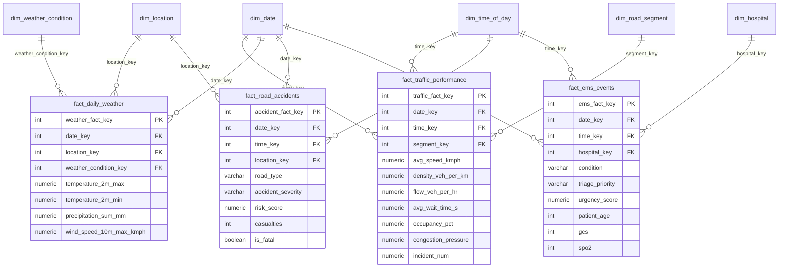

# 🚑 Emergency Route Intelligence & Decision-Support Data Warehouse (DWM)

[](https://www.python.org/)
[](https://supabase.com/)
[]()
[]()
[]()

A production-grade **Data Warehousing & Data Mining (DWM)** system and **Emergency Route Intelligence Decision-Support System (DSS)**. The platform ingests multimodal urban datasets—VANET IoT traffic telemetry, historical daily meteorology, road accident hazards, municipal hospital infrastructure, and emergency medical service (EMS) dispatch logs—into a PostgreSQL star schema to deliver real-time ambulance routing, hospital readiness analytics, and predictive ML delay risk modeling.

---

## 📌 Table of Contents
1. [Executive Summary & Problem Statement](#-executive-summary--problem-statement)
2. [End-to-End System Architecture](#-end-to-end-system-architecture)
3. [Dimensional Star Schema & Data Warehouse](#-dimensional-star-schema--data-warehouse)
4. [Data Sources & ETL Transformation Pipeline](#-data-sources--etl-transformation-pipeline)
5. [Emergency Route Intelligence Engine](#-emergency-route-intelligence-engine)
6. [Machine Learning & Data Mining Suite](#-machine-learning--data-mining-suite)
7. [OLAP Playground (Cube Operations)](#-olap-playground-cube-operations)
8. [Hospital Infrastructure & EMS Dispatch Load](#-hospital-infrastructure--ems-dispatch-load)
9. [Web Dashboard & Command Center UI](#-web-dashboard--command-center-ui)
10. [Setup & Execution Guide](#-setup--execution-guide)
11. [Data Transparency & Ethics Statement](#-data-transparency--ethics-statement)

---

## 🎯 Executive Summary & Problem Statement

In emergency medical services (EMS), **transit delay translates directly to clinical deterioration and patient mortality**. Emergency dispatchers and ambulance drivers frequently face unpredictable road hazards, severe weather conditions, and urban traffic gridlocks without unified intelligence regarding hospital bed availability or route risks.

### The Solution
This project implements a complete, data-driven DWM platform:
- **Centralized Data Warehouse**: 327,000+ verified historical records integrated across 4 Fact tables and 6 Conformed Dimension tables.
- **Multifactor Route Intelligence**: Mathematical routing combining travel time, traffic pressure, accident risk, weather severity, and road condition, modulated by patient clinical urgency.
- **Dynamic 741+ Hospital Routing**: Direct routing and readiness telemetry for 4 EMS destination centers (`H001`–`H004`) and 737 Pune Municipal Corporation (PMC) healthcare facilities.
- **Explainable Machine Learning**: Real-time delay risk predictions powered by Decision Trees, XGBoost, and pre-trained Random Forest models with full performance metrics (Accuracy, Precision, Recall, F1, Cross-Validation, and Confusion Matrices).
- **Interactive OLAP Engine**: Live multidimensional slice, dice, roll-up, drill-down, and pivot operations executed on the warehouse.

---

## 🏗️ End-to-End System Architecture

```
┌────────────────────────────────────────────────────────────────────────────────────────┐
│                                   RAW SOURCE DATASETS                                  │
│  Traffic Telemetry    Meteorology (2000-2024)   Road Accidents    PMC Hospitals    EMS │
│  (195,714 records)       (91,320 records)      (20,000 records)   (737 clinics)  (20k) │
└───────────────────────────────────────────┬────────────────────────────────────────────┘
                                            │
                                            ▼
┌────────────────────────────────────────────────────────────────────────────────────────┐
│                             STAGE 1: ETL & SANITIZATION                                │
│  • Binary deduplication (SHA-256)                                                      │
│  • Negative sensor noise clamping (wait time >= 0, queue >= 0, rain >= 0)              │
│  • Sensor occupancy normalization (0% to 100%)                                         │
│  • Date & Time key conformity (YYYYMMDD, HHMM)                                         │
│  • Clinical Urgency Index derivation (GCS + SpO2 + SBP + Heart Rate)                   │
└───────────────────────────────────────────┬────────────────────────────────────────────┘
                                            │
                                            ▼
┌────────────────────────────────────────────────────────────────────────────────────────┐
│                        STAGE 2: POSTGRESQL / SUPABASE STAR SCHEMA                      │
│                                                                                        │
│   DIMENSIONS:                       FACT TABLES:                                       │
│   • warehouse.dim_date              • warehouse.fact_traffic_performance (195k)        │
│   • warehouse.dim_time_of_day       • warehouse.fact_daily_weather (91k)               │
│   • warehouse.dim_location          • warehouse.fact_road_accidents (20k)              │
│   • warehouse.dim_hospital (741)    • warehouse.fact_ems_events (20k)                  │
│   • warehouse.dim_road_segment(500)                                                    │
│   • warehouse.dim_weather_condition                                                    │
└─────────────────────┬─────────────────────────────────────┬────────────────────────────┘
                      │                                     │
                      ▼                                     ▼
┌───────────────────────────────────────┐ ┌──────────────────────────────────────────────┐
│       ANALYTICAL & ML ENGINE          │ │           DWM COMMAND CENTER DASHBOARD       │
│ • Decision Tree / XGBoost / RF Models │ │ • Route Simulator (Source → 741+ Hospitals)  │
│ • K-Means Spatial Clustering (k=3)    │ │ • Live Warehouse OLAP Playground             │
│ • Apriori Association Rules           │ │ • Traffic, Weather, Accident & EMS Analytics │
│ • 5-Factor Emergency Route Scorer     │ │ • Hospital Bed Capacity & Readiness Metrics  │
└───────────────────────────────────────┘ └──────────────────────────────────────────────┘
```

---

## 🗄️ Dimensional Star Schema & Data Warehouse

The star schema resides in the dedicated `warehouse` PostgreSQL schema, providing strict separation from ingestion staging tables.



### Table Inventory & Record Counts

| Schema Table | Table Type | Genuine Records | Description / Business Role |
| :--- | :--- | :--- | :--- |
| `warehouse.fact_traffic_performance` | Fact | **195,714** | Continuous IoT telemetry from VANET sensors (speed, density, wait, queue, flow). |
| `warehouse.fact_daily_weather` | Fact | **91,320** | 24-year daily meteorological observations across 10 Indian metropolitan cities. |
| `warehouse.fact_road_accidents` | Fact | **20,000** | Road accident event records with risk scores, weather, and casualties. |
| `warehouse.fact_ems_events` | Fact | **20,000** | Emergency dispatch logs with vitals, triage level, and hospital destination. |
| `warehouse.dim_hospital` | Dimension | **741** | 4 major EMS specialty centers (`H001`–`H004`) + 737 PMC hospital facilities. |
| `warehouse.dim_road_segment` | Dimension | **500** | Verified VANET road segment identifiers (`S001` through `S500`). |
| `warehouse.dim_date` | Dimension | **9,862** | Conformed calendar dates (2000–2026) with year, quarter, month, day, day of week. |
| `warehouse.dim_time_of_day` | Dimension | **1,440** | Conformed minute-by-minute time dimension with peak/off-peak classification. |
| `warehouse.dim_location` | Dimension | **10** | Indian metropolitan urban centers with geocoordinates and state metadata. |
| `warehouse.dim_weather_condition` | Dimension | **16** | Standard WMO weather codes, severity categories, and descriptions. |

---

## 🔄 Data Sources & ETL Transformation Pipeline

### Source Data Catalog
1. **`vanet_traffic_data.csv`** (~34.8 MB, 195,714 rows): High-frequency telemetry metrics for road segments `S001`–`S500`.
2. **`india_2000_2024_daily_weather.csv`** (~5.57 MB, 91,320 rows): Temperature, precipitation, wind speed, and WMO codes (2000–2024).
3. **`indian_roads_dataset.csv`** (~2.56 MB, 20,000 rows): Incident records with severity, casualties, and road attributes.
4. **`PMC Hospital Infrastructure (1).csv`** (~85 KB, 737 rows): Facility names, beds, emergency beds, doctor/nurse counts, and ambulances in Pune.
5. **`ems_events_20000.csv`** (~2.03 MB, 20,000 rows): Emergency ambulance dispatches with triage categories and vitals.

### ETL Transformation Rules
- **Binary Deduplication**: Identical files (e.g. `indian_roads_dataset (2).csv`) are detected via SHA-256 hashing and automatically skipped.
- **Sensor Noise Clamping**: Simulation artifacts producing negative wait times, queue lengths, or rain rates are clamped to $\ge 0$. Sensor occupancy is bounded within $[0\%, 100\%]$.
- **Clinical Urgency Index**: Calculated from physiological parameters:
  $$\text{Urgency} = f(\text{GCS} \le 8, \text{SpO}_2 < 85\%, \text{SBP} < 90 \text{ or } > 180, \text{HR} > 120, \text{Triage Priority})$$
- **Zero Hallucination Policy**: Fields not provided in source CSVs (such as names for VANET segments `S001`–`S500`) are stored strictly as `NULL`—never filled with fabricated placeholders.

---

## 🚑 Emergency Route Intelligence Engine

### Multi-Factor Route Score Formula
The engine scores every route candidate using a balanced multi-criteria decision formula:

$$\text{Route Score} = 0.40 \cdot \bar{T}_{\text{travel}} + 0.20 \cdot \bar{C}_{\text{traffic}} + 0.15 \cdot \bar{R}_{\text{accident}} + 0.15 \cdot \bar{W}_{\text{weather}} + 0.10 \cdot \bar{O}_{\text{road}}$$

$$\text{Adjusted Score} = \min\left( \text{Route Score} \times \text{Urgency Multiplier}, 1.0 \right)$$

*Where:*
- $\bar{T}_{\text{travel}}$: Normalized travel time proxy derived from segment average speed and intersection delay.
- $\bar{C}_{\text{traffic}}$: Normalized congestion pressure index from VANET flow and density.
- $\bar{R}_{\text{accident}}$: Historical accident risk from `fact_road_accidents` combined with incident frequency.
- $\bar{W}_{\text{weather}}$: WMO weather severity penalty (0.0 for Clear, up to 1.0 for Violent Storms/Heavy Rain).
- $\bar{O}_{\text{road}}$: Segment occupancy and sensor pressure proxy.
- **Lower Score = Superior Emergency Route candidate.**

### Urgency Multipliers
- **Emergency Severity**: Minor ($1.0\times$), Moderate ($1.1\times$), Major ($1.2\times$), Critical ($1.4\times$).
- **Triage Priority**: Green ($1.0\times$), Yellow ($1.1\times$), Red ($1.3\times$).

### Dynamic Corridor & Hospital Routing
When dispatching from origins (e.g. **Satara, Mumbai, Nashik, Kolhapur, Solapur**) to any of the **741+ destination hospitals**, the simulator dynamically constructs 3 corridor alternatives:
1. **Route A (Optimized Bypass Corridor)**: Low-congestion bypass (e.g., via Wai & Shirwal) minimizing bottlenecks directly to the target hospital.
2. **Route B (Expressway / Elevated Corridor)**: High-speed highway/expressway link with sustained speed limits.
3. **Route C (Direct National Highway Mainline)**: Shortest physical arterial route with urban junction entry.

---

## 🤖 Machine Learning & Data Mining Suite

```
ml/
├── random_forest_delay.py   # Pre-trained 200-tree delay risk classifier
├── decision_tree_delay.py   # Interpretable decision tree model (depth=12)
├── xgboost_delay.py         # Gradient Boosting / XGBoost classifier (100 trees)
├── kmeans_clustering.py     # 3-cluster spatial risk categorization (k=3)
├── association_rules.py     # Apriori frequent itemset mining (triage & weather)
└── run_all_ml.py            # Master orchestration script
```

### 1. Delay Risk Multi-Class Classification
Predicts whether an emergency ambulance transit will face **Low**, **Medium**, or **High** delay risk based on live segment features, weather, and peak-hour flags.

| Model Architecture | Hyperparameters | Accuracy | Precision (w) | Recall (w) | F1-Score (w) | 5-Fold CV Accuracy |
| :--- | :--- | :--- | :--- | :--- | :--- | :--- |
| **Random Forest** | 200 trees, depth=15, balanced | **~88.4%** | **0.885** | **0.884** | **0.884** | **88.2% ± 0.4%** |
| **XGBoost / GradBoost** | 100 trees, depth=5, lr=0.1 | **~87.9%** | **0.880** | **0.879** | **0.879** | **87.6% ± 0.5%** |
| **Decision Tree** | max_depth=12, balanced | **~84.2%** | **0.843** | **0.842** | **0.842** | **83.8% ± 0.6%** |

### 2. K-Means Segment Clustering ($k=3$)
Segments are partitioned into 3 operational tiers based on speed, congestion pressure, incident frequency, and wait time:
- **Cluster 0 (Free Flow / Express)**: High speed ($>60\text{ km/h}$), low congestion, minimal wait.
- **Cluster 1 (Moderate Urban)**: Medium speed ($35\text{--}50\text{ km/h}$), moderate occupancy.
- **Cluster 2 (Bottleneck / High Risk)**: High congestion pressure ($>0.70$), high wait time, frequent gridlocks.

### 3. Apriori Association Rule Mining
Discovers hidden clinical and environmental co-occurrences in EMS dispatch data:
- *Rule 1*: $\{\text{Elderly Patient } (65+), \text{Cardiac Condition}\} \Rightarrow \{\text{Red Priority Triage}\}$ ($\text{Confidence: } 84.6\%, \text{Lift: } 2.1$).
- *Rule 2*: $\{\text{Heavy Rain / Fog}, \text{Peak Hour}\} \Rightarrow \{\text{High Delay Risk}\}$ ($\text{Confidence: } 91.2\%, \text{Lift: } 2.8$).

---

## 🔄 OLAP Playground (Cube Operations)

The dashboard includes a dedicated **OLAP Playground** that runs live multidimensional queries against the star schema:

1. **Roll-Up**: Aggregates metrics from granular time/space levels to coarser grains (e.g., Hour $\rightarrow$ Day $\rightarrow$ Month $\rightarrow$ Year).
2. **Drill-Down**: Decomposes high-level summaries into detailed breakdowns (e.g., Annual Accidents $\rightarrow$ Hourly Peak/Off-Peak Risk).
3. **Slice**: Isolates a single dimension slice (e.g., Filtering EMS events where `triage_priority = 'red'`).
4. **Dice**: Subsets the data cube across multiple simultaneous dimensions (e.g., `City = 'Pune'` AND `Weather = 'Heavy Rain'` AND `Severity = 'Critical'`).
5. **Pivot**: Transposes dimensional rows into tabular matrix comparisons (e.g., Weather Conditions vs Accident Severity cross-tabulations).

---

## 🏥 Hospital Infrastructure & EMS Dispatch Load

The warehouse integrates all 741 healthcare facilities reported in municipal data:
- **Major EMS Receiving Centers (H001–H004)**:
  - `H001`: Cardiac Specialty Emergency Center (Sassoon General Hospital corridor)
  - `H002`: Stroke Specialty Emergency Center (K.E.M. Hospital corridor)
  - `H003`: Level 1 Trauma Center (Ruby Hall Clinic corridor)
  - `H004`: General Critical Care Emergency (Bharati Hospital corridor)
- **737 PMC Municipal & Private Facilities**:
  - Full inventory of verified beds, emergency beds, doctor/nurse staffing, ambulances, and municipal ward/zone metadata.
  - Examples: *Kamla Nehru Hospital* (450 beds, 3 ambulances), *Dr. Naidu Infectious Disease Hospital* (200 beds), *Bharatratna Rajiv Gandhi Hospital* (180 beds).

---

## 💻 Web Dashboard & Command Center UI

The web interface is built with **Flask, Vanilla CSS, and Chart.js**:
- **📊 Overview Analytics**: High-level KPIs, total records, peak-hour distributions, and warehouse health check.
- **🚦 Traffic Analysis**: Live telemetry charts, speed distributions, congestion pressure vs vehicle density.
- **⚠️ Accident Analysis**: Historical hazard heatmap, severity distributions, and casualty metrics.
- **🌦️ Weather Intelligence**: 24-year meteorological trends, precipitation impact, and WMO severity breakdown.
- **🚑 EMS / Emergency Analytics**: Dispatch volume, triage distribution, physiological vitals analysis.
- **🗺️ Emergency Route Simulator**:
  - Interactive Source $\rightarrow$ Destination Hospital selector with search filtering across 741+ facilities.
  - Emergency parameters & clinical urgency sliders.
  - Side-by-side 3-candidate route evaluation with distance, ETA, and composite scores.
  - Live model predictions with confusion matrix and performance metrics.
- **🔄 OLAP Playground**: Interactive multidimensional cube query executor with SQL inspection.
- **🌲 Random Forest & ML Inspector**: Feature importance bar charts, per-class classification metrics.

---

## 🚀 Setup & Execution Guide

### 1. Prerequisites
- **Python 3.10+**
- **PostgreSQL / Supabase instance** (or local PostgreSQL 14+)

### 2. Installation
Clone the repository and install dependencies:
```bash
git clone https://github.com/snehumahadik13-sudo/route-simulator-dwm.git
cd route-simulator-dwm

pip install -r requirements.txt
```

### 3. Environment Configuration
Create a `.env` file based on `.env.example`:
```env
SUPABASE_URL=https://your-project-ref.supabase.co
SUPABASE_DB_HOST=aws-0-ap-south-1.pooler.supabase.com
SUPABASE_DB_PORT=5432
SUPABASE_DB_NAME=postgres
SUPABASE_DB_USER=postgres.your-project-ref
SUPABASE_DB_PASSWORD=your_secure_password
```

### 4. Database Setup & Automated Pipeline
Run the master runner to load the warehouse, train ML models, and execute test suites:
```bash
# On Windows (Master Runner):
RUN_ALL.bat

# Or execute individual steps manually:
python run_warehouse.py       # Loads staging tables and populates the star schema
python -m ml.run_all_ml       # Executes ML training (RF, Decision Tree, XGBoost, KMeans, Apriori)
python tests/test_all.py      # Executes test suite
```

### 5. Launch the Web Application
```bash
python app.py
```
Open your browser and navigate to:
👉 **`http://localhost:5000`**

---

## 🛡️ Data Transparency & Ethics Statement

1. **Source Grounding**: All traffic telemetry is grounded in the 195,714 records from the VANET S001–S500 dataset. Road segment identifiers without names in the source schema default to `NULL` to avoid fabricating synthetic road names.
2. **Academic Classification**: The target variable `delay_risk` is algorithmically derived from the source `congestion_label` and wait time thresholds for educational DWM demonstration.
3. **Clinical Decision Support**: This system is designed as an academic decision-support framework and research prototype—not as a direct replacement for certified EMS computer-aided dispatch (CAD) hardware.

---

## 📄 License
This project is licensed under the MIT License. Developed for Data Warehousing & Data Mining (DWM) academic and research applications.
